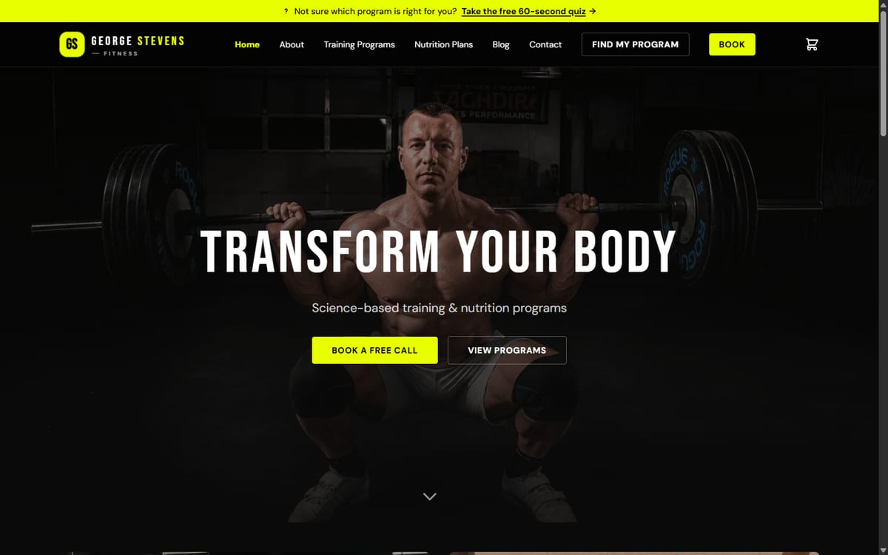
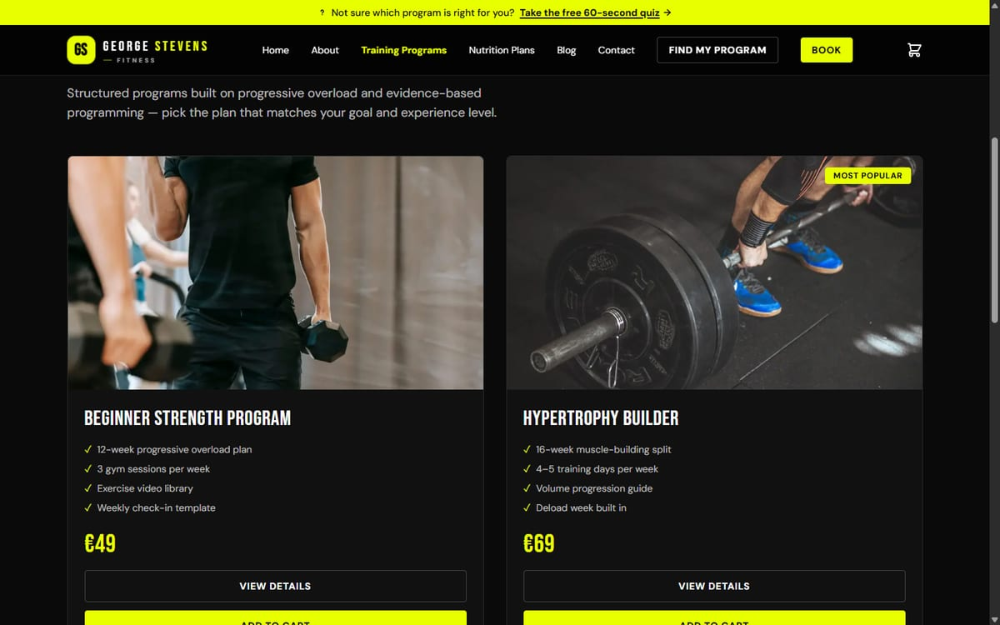
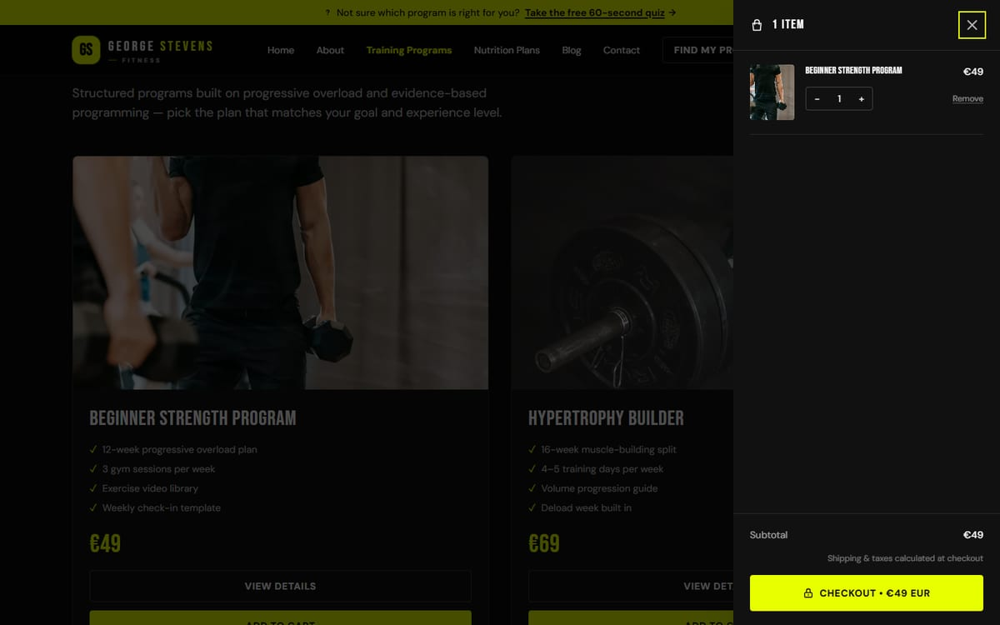
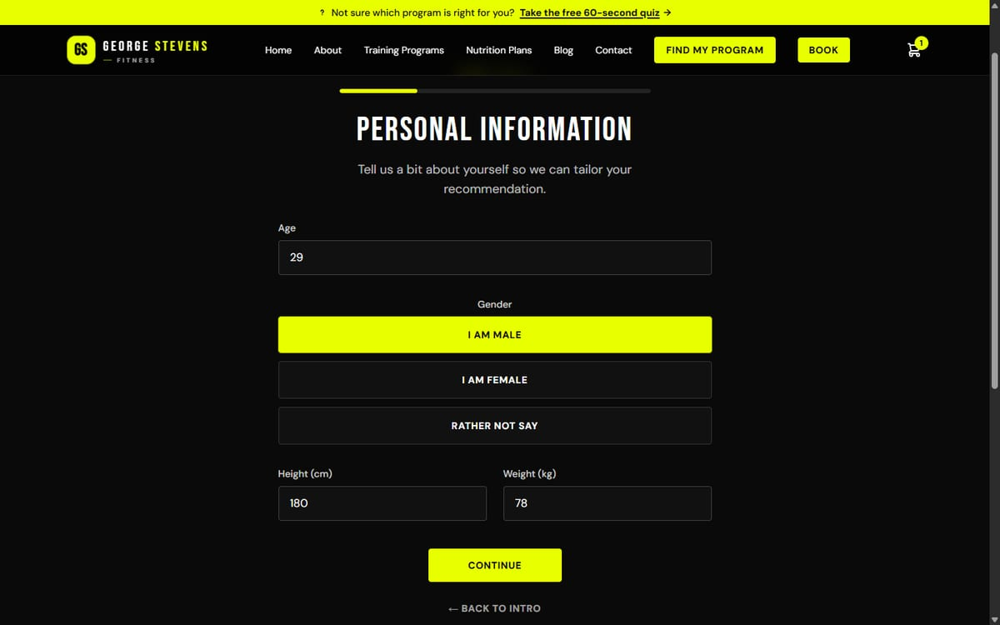
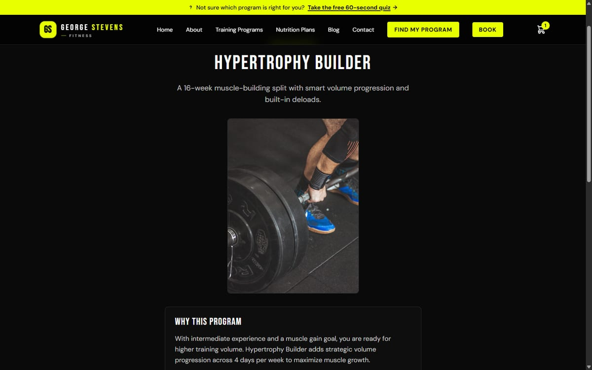
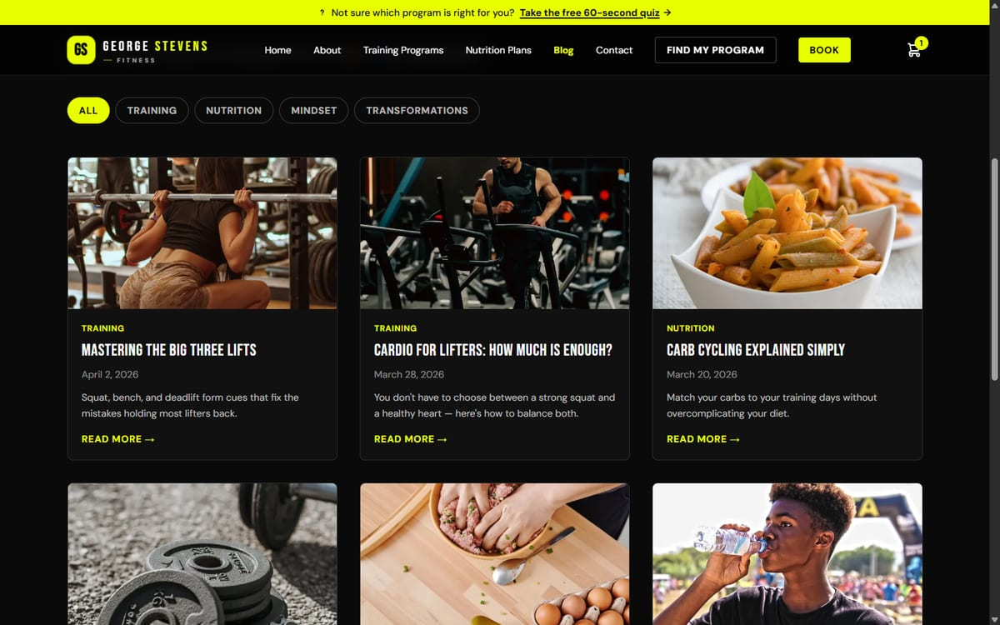
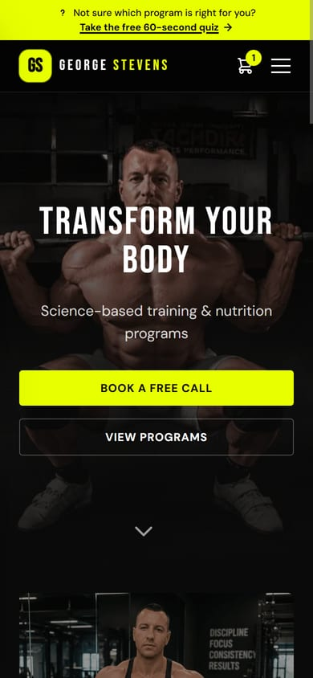
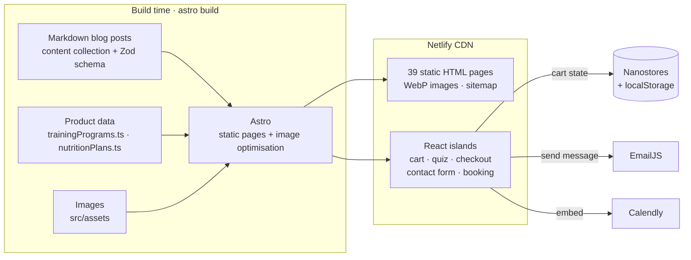
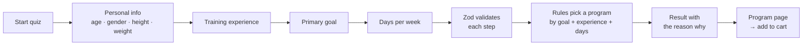

<p align="center">
  
</p>

<h1 align="center">George Stevens Fitness</h1>

<p align="center">
  A marketing and e-commerce site for a personal trainer: training programs and nutrition plans with a cart, a quiz that recommends a program, a blog, online booking and a contact form. Built with Astro, with React islands for the interactive parts.
</p>

<p align="center">
  <a href="https://beantrainingcoach.netlify.app/"><b>🌐 Live demo</b></a>
</p>



## Screenshots

| Training programs | Cart drawer |
| --- | --- |
|  |  |

| Program quiz | Quiz result |
| --- | --- |
|  |  |

| Blog with categories | Mobile |
| --- | --- |
|  |  |

## Features

- **Program quiz.** Four steps (personal info, experience, goal, days per week), each validated with Zod before you can continue. Rules in `recommendTrainingProgram.ts` pick a program and explain why it fits.
- **Shop.** Training programs and nutrition plans with detail pages, a cart drawer, quantity controls and a checkout form with validation. The cart is a Nanostores store saved to `localStorage`, so it survives reloads. Checkout is a demo: no card data is sent anywhere.
- **Blog.** 15 Markdown posts in an Astro content collection with a typed schema, category tabs and pagination, all generated as static pages.
- **Booking.** An embedded Calendly calendar for free calls.
- **Contact form.** Sends email through EmailJS straight from the browser, with a honeypot field and rate limiting against spam.
- **Performance and SEO.** Pages are static HTML. Images are converted to WebP and resized at build time. A sitemap is generated automatically.
- **Accessibility.** "Skip to main content" link, labelled navigation, keyboard focus styles, and a progress bar with ARIA values in the quiz.

## Architecture



Most of the site is plain HTML with no JavaScript. React loads only for the parts that need it, which keeps pages fast.

## Program quiz flow



## Tech stack

| Area | Tools |
| --- | --- |
| Framework | Astro 6 (static output), React 19 islands, TypeScript |
| Styling | Tailwind CSS 4 |
| State | Nanostores (cart) |
| Forms and validation | React Hook Form, Zod |
| Integrations | EmailJS (contact form), Calendly (booking) |
| UI | Embla Carousel (transformation slider) |
| Tooling | ESLint, Prettier, `astro check`, sharp |
| Hosting | Netlify |

## Project structure

The app lives in `personal-trainer/`. `netlify.toml` in the repo root tells Netlify to build from there.

```text
personal-trainer/
├── public/              Static files (favicon, robots.txt)
├── scripts/             Build helpers (asset compression)
├── src/
│   ├── assets/          Images processed by Astro
│   ├── components/      Astro and React components, grouped by feature
│   ├── config/          Site-wide config (navigation, Calendly URL)
│   ├── content/blog/    Markdown blog posts
│   ├── data/            Product catalogue (types, training programs, nutrition plans)
│   ├── layouts/         BaseLayout.astro
│   ├── lib/             Helpers (blog, images, quiz schema and recommendation)
│   ├── pages/           File-based routes
│   ├── store/           Cart state (Nanostores)
│   └── styles/          Global CSS and Tailwind theme
├── astro.config.mjs
└── package.json
```

### Routes

| Route | Page |
| --- | --- |
| `/` | Home |
| `/about` | About |
| `/programs`, `/programs/[id]` | Training programs and their detail pages |
| `/nutrition`, `/nutrition/[id]` | Nutrition plans and their detail pages |
| `/blog`, `/blog/[slug]` | Blog with categories and pagination |
| `/program-selector` | Program quiz |
| `/book` | Calendly booking |
| `/contact` | Contact form |
| `/checkout` | Checkout (demo) |

## Running locally

You need Node.js 22.12 or newer.

```sh
cd personal-trainer
npm install
cp .env.example .env    # fill in the values below
npm run dev             # http://localhost:4321
```

### Environment variables

All variables start with `PUBLIC_`, so Astro includes them in the browser bundle. EmailJS public keys are designed to be public.

| Variable | Required | What it is |
| --- | --- | --- |
| `PUBLIC_EMAILJS_SERVICE_ID` | For the contact form | EmailJS service ID |
| `PUBLIC_EMAILJS_TEMPLATE_ID` | For the contact form | EmailJS template ID |
| `PUBLIC_EMAILJS_PUBLIC_KEY` | For the contact form | EmailJS public key |
| `PUBLIC_CALENDLY_URL` | No | Calendly event URL. Defaults to the one in `src/config/site.ts` |

### Scripts

| Command | What it does |
| --- | --- |
| `npm run dev` | Dev server at `localhost:4321` |
| `npm run build` | Production build into `dist/` |
| `npm run preview` | Serve the production build locally |
| `npm run check` | TypeScript and Astro diagnostics |
| `npm run lint` | ESLint |
| `npm run format` | Prettier |
| `npm run compress-assets` | Shrink oversized images in `src/assets/` |

## Adding content

- **Blog post:** add a Markdown file to `src/content/blog/` with `title`, `pubDate`, `description`, `author`, `image`, `category` and `tags` in the frontmatter. The build fails if a field is missing or the category is unknown. A cover image in `src/assets/` is found by its file name.
- **Product:** edit `src/data/trainingPrograms.ts` or `src/data/nutritionPlans.ts`. New cover images in `src/assets/` are found automatically.

## Deployment

Netlify builds the site on every push to `main`, using the settings in `netlify.toml` (base `personal-trainer`, command `npm run build`, output `dist`, Node 22). Set the `PUBLIC_*` variables in Netlify under Site configuration → Environment variables. If the domain changes, update `site` in `astro.config.mjs` and the sitemap link in `public/robots.txt`.
